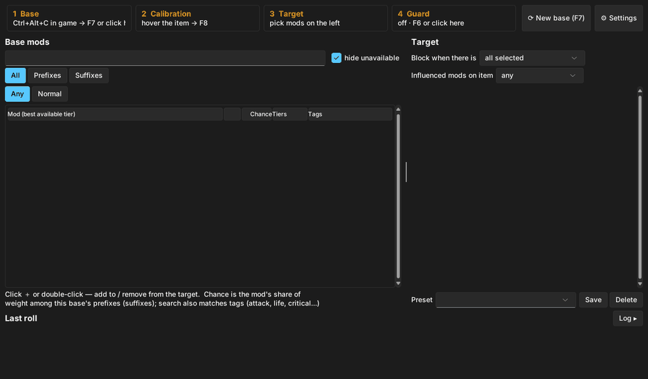

# PoE Craft Guard

**[Русская версия](README.md)**

**Never reroll a good item again.** Spam the orb — the program reads the item tooltip, and when the mods
you picked roll, it beeps and **blocks the left click**.
The program never clicks for you: you click every orb yourself, it only stops the extra click.

### [⬇ Download PoECraftGuard.exe](https://github.com/kotrow1/poecraft/releases/latest/download/PoECraftGuard.exe)
Windows 10/11 · free · no install · self-updating · [all releases](https://github.com/kotrow1/poecraft/releases)

- **Any mods and tiers** — the base's mod list with chances and Harvest tags, “T3 or better”, all or any of
  the selected, number of influenced mods (for Maven's Orb), elevated mods, cluster jewels (pool by enchant).
- **Fast** — 40–50 ms per roll after the first recognition.
- **Step mode** — the next click only goes through after the result is checked, no rerolling a good item by momentum.
- **English and Russian game client**, interface in English and Russian.
- **Doesn't touch the game** — no memory reading, no file changes, no key presses. Only the screen and the clipboard.
- **Open source** — everything the program does is in this repository.

> **Game rules.** We've sent a description of the program to Grinding Gear Games support and are waiting
> for their answer. It will be published here word for word.

## Installation
**Easiest — `PoECraftGuard.exe`:** download it from the
[releases](https://github.com/kotrow1/poecraft/releases/latest) page, put it in its own folder (`data` and
`config.json` will appear next to it) and run it. No Python needed, it updates itself.
Windows may show “Windows protected your PC” — “More info” → “Run anyway”
(the program has no paid code signature).

**Or from source** — run `run.bat`. It will:
1. find Python, or install Python 3.12 if there is none (via winget or from python.org);
2. install the required libraries;
3. check the English Windows text recognition pack and offer to install it if it's missing
   (Windows will ask for administrator rights — agree);
4. start the program. On the first run the mod database is downloaded (~55 MB, the `data` folder).

**The mod database updates itself:** on every start the program checks whether a new export of the game
data is out (after a patch) and downloads it. Without internet it works on the saved database.

An internet connection is needed on the first run. If the game runs as administrator, run
the program as administrator too, otherwise it can't block clicks in the game.

## Russian game client
Both English and Russian game clients are supported. The program detects the client language from the
copied item (Ctrl+Alt+C) — mods are shown and recognized in the game's language. The first Russian item
downloads the Russian data (~20 MB). Reading a Russian tooltip needs the Russian Windows text recognition
pack — if it's missing, the program offers to install it.
The program's own window language (“⚙ Settings” → “General”) is independent of the client language.

## How to use — 4 steps (shown at the top of the window, done steps turn green)
1. **Base** — Ctrl+Alt+C on the item in game, then F7 (or the “⟳ New base” button).
   To switch items do the same: Ctrl+Alt+C on the new item and F7.
2. **Calibration** — hover the item in the crafting slot and press F8.
   Calibration is kept between runs; redo it only if you moved the game window.
3. **Target** — on the left is the list of the base's mods with filters (prefixes/suffixes,
   influence, elevated). Press ＋ next to a mod — it appears on the right. In its card choose
   the tier you'll accept (“T3 or better”). At the top right: all mods or any of them, and how
   many influenced mods there must be (e.g. “exactly 2” for a Maven's Orb).
   The target can be saved as a preset.
4. **Guard** — F6 (or click the tile). Spam the orb. When the target rolls you hear a beep and
   the left click is blocked. “Last roll” at the bottom shows the recognized mods,
   matching ones are green.

The status is also shown above the game — a small indicator in the top right corner of the
screen; clicks pass through it.

## Mod chance and tags
Every mod in the list has a **chance** — its share of weight among this base's prefixes
(or suffixes) at its ilvl — and **tags** (attack, critical, life, defences…) that Harvest
reforges use. Search matches tags too.

## Cluster jewels
Ctrl+Alt+C on a cluster → F7: the program reads the enchant and shows the notables and mods
that can roll on that particular cluster.

## Settings (⚙ button)
Sections on the left: “Hotkeys”, “General”, “Guard”, “About”; “Save” / “Cancel” at the bottom.
- **Language** — Russian or English (“General”), switches right after “Save”.
- **Hotkeys** — any keys; defaults: F7 import, F8 calibration, F6 guard, F10 test.
- **Step mode** — after a click the next click goes through only once the program has seen
  and checked the result. A good roll can't be rerolled by momentum.
- **Shift lock** — with the guard on: hold Shift, click the item — Shift “sticks” and you can
  release it. To release it press Shift again or turn the guard off.
  While the lock is active, Shift is held system-wide.
- Block time, holding the block until the guard key is pressed again, window above the game.

## Updates
“⚙ Settings” → “About”: version, “Release notes”, “Report a bug on GitHub”, the “Check now” button.
With “Update automatically” on (default) the program checks for updates at startup and every
6 hours and downloads the new version — it starts working after a restart. The `data` folder and
your settings are left alone, previous files are kept in `backup`.

## Troubleshooting
- “Log” at the bottom of the window shows details, F10 recognizes the tooltip right now.
- The game merges identical lines from different mods into one — such lines may be identified imprecisely.
- If the tier is ambiguous it shows “T2/T3”; the condition uses the better one.
